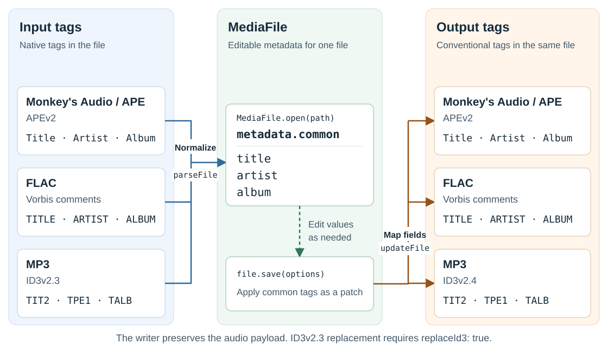

[](https://github.com/Borewit/music-metadata/actions/workflows/ci.yml)
[](https://npmjs.org/package/music-metadata)
[](https://npmcharts.com/compare/music-metadata?start=600&interval=7)
[](https://codecov.io/gh/Borewit/music-metadata)
[](https://github.com/Borewit/music-metadata/actions/workflows/codeql-analysis.yml)
[](https://socket.dev/npm/package/music-metadata)

# music-metadata

**Read and write audio metadata in Node.js and browsers.**


`music-metadata` extracts tags, cover art and audio properties from files, streams,
buffers and Blobs. It provides common field names across formats, plus access to
native tags. It also edits tags and cover art in supported formats without
re-encoding audio.

[Features](#features) · [Compatibility](#compatibility) · [Sponsoring](#sponsoring) · [Installation](#installation) · [Reading API](#reading-metadata) · [Parsing options](#ioptions-interface) · [Writing API](#writing-metadata) · [FAQ](#frequently-asked-questions)

## Features

- **Common and native tags:** Read normalized fields across formats, or access the original tags.
- **Audio properties:** Read duration, codec, bitrate, sample rate, bit depth and track information.
- **Flexible input:** Read files, Node.js and web streams, buffers, Blobs and custom tokenizers.
- **Metadata editing:** Update files in Node.js or return new buffers in Node.js and browsers. See [Writing metadata](#writing-metadata) for supported formats.
- **TypeScript support:** Typed metadata and a promise-based API.

### Common metadata across formats

Readers map native tags to normalized fields in metadata.common. For example, APEv2 Title, Vorbis TITLE, and ID3v2 TIT2 all map to title, regardless of the original tagging format.

Simply choose which fields to update, and the writer maps those changes to the conventional tag format for the file. This follows a straightforward philosophy: **Read the past, write the future.** Legacy tag formats remain readable, while new metadata is written using modern, widely adopted standards.



### Support for audio file types

The following formats support **reading**. For supported write formats and examples, see [Writing metadata](#writing-metadata).

| Audio format                                                              | Description                                               | Logo                                                                                             |
|---------------------------------------------------------------------------|-----------------------------------------------------------|--------------------------------------------------------------------------------------------------|
| [AIFF / AIFF-C](https://wikipedia.org/wiki/Audio_Interchange_File_Format) | Audio Interchange File Format                             |      |
| [AAC](https://en.wikipedia.org/wiki/Advanced_Audio_Coding)                | ADTS / Advanced Audio Coding                              |                               |
| [APE](https://wikipedia.org/wiki/Monkey's_Audio)                          | Monkey's Audio                                            |                          |
| [ASF](https://wikipedia.org/wiki/Advanced_Systems_Format)                 | Advanced Systems Format                                   |                                                                                                  |
| [BWF](https://en.wikipedia.org/wiki/Broadcast_Wave_Format)                | Extended WAV format for broadcast and archiving           |                                                                                                  |
| [CAF](https://en.wikipedia.org/wiki/Core_Audio_File_Format)               | Core Audio File Format                                    |      |
| [DSDIFF](https://wikipedia.org/wiki/Direct_Stream_Digital)                | Philips DSDIFF                                            |                                        |
| [DSF](https://wikipedia.org/wiki/Direct_Stream_Digital)                   | Sony's DSD Stream File                                    |                                        |
| [FLAC](https://wikipedia.org/wiki/FLAC)                                   | Free Lossless Audio Codec                                 |                                      |
| [MP2](https://wikipedia.org/wiki/MPEG-1_Audio_Layer_II)                   | MPEG-1 Audio Layer II (predecessor to MP3)                |                                                                                                  |
| [Matroska](https://wikipedia.org/wiki/Matroska)                           | Matroska (EBML), mka, mkv                                 |                         |
| [MP3](https://wikipedia.org/wiki/MP3)                                     | MPEG-1 / MPEG-2 Audio Layer III                           |                                      |
| [MPC](https://wikipedia.org/wiki/Musepack)                                | Musepack SV7                                              |                              |
| [MPEG 4](https://wikipedia.org/wiki/MPEG-4)                               | mp4, m4a, m4v                                             |                            |
| [Ogg](https://en.wikipedia.org/wiki/Ogg)                                  | Open container format                                     |                                        |
| [Opus](https://wikipedia.org/wiki/Opus_(audio_format))                    | Low-latency, high-quality codec for speech and music      |                                      |
| [Speex](https://wikipedia.org/wiki/Speex)                                 | Open-source speech codec optimized for VoIP               |                               |
| [Theora](https://en.wikipedia.org/wiki/Theora)                            | Open video compression format (typically paired with Ogg) |                             |
| [Vorbis](https://wikipedia.org/wiki/Ogg_Vorbis)                           | Vorbis audio compression                                  |                  |
| [WAV](https://wikipedia.org/wiki/WAV)                                     | Uncompressed PCM audio in RIFF container                  |                                                                                                  |
| [WebM](https://wikipedia.org/wiki/WebM)                                   | WebM                                                      |                                  |
| [WV](https://wikipedia.org/wiki/WavPack)                                  | WavPack                                                   |                                |
| [WMA](https://wikipedia.org/wiki/Windows_Media_Audio)                     | Windows Media Audio                                       |  |

### Supported tag headers

Supported tag formats:
- [APE](https://wikipedia.org/wiki/APE_tag)
- [ASF](https://wikipedia.org/wiki/Advanced_Systems_Format)
- EXIF 2.3
- [ID3](https://wikipedia.org/wiki/ID3): ID3v1, ID3v1.1, ID3v2.2, [ID3v2.3](http://id3.org/id3v2.3.0), [ID3v2.4](http://id3.org/id3v2.4.0-frames) and [ID3v2 Chapters 1.0](https://mutagen-specs.readthedocs.io/en/latest/id3/id3v2-chapters-1.0.html)
- [iTunes](https://github.com/sergiomb2/libmp4v2/wiki/iTunesMetadata)
- [RIFF](https://wikipedia.org/wiki/Resource_Interchange_File_Format)/INFO
- [Vorbis comment](https://wikipedia.org/wiki/Vorbis_comment)
- [AIFF](https://wikipedia.org/wiki/Audio_Interchange_File_Format)
- [CAF](https://developer.apple.com/library/archive/documentation/MusicAudio/Reference/CAFSpec/CAF_spec/CAF_spec.html)

Supported lyric formats:
- [LRC](https://en.wikipedia.org/wiki/LRC_(file_format))
- Synchronized lyrics (SYLT)
- Unsynchronized lyrics (USLT)

Support for [MusicBrainz](https://musicbrainz.org/) tags as written by [Picard](https://picard.musicbrainz.org/).
[ReplayGain](https://wiki.hydrogenaud.io/index.php?title=ReplayGain) tags are supported.

### Audio format & encoding details

Available [audio properties](#metadataformat) include:
- [Bit rate](https://wikipedia.org/wiki/Bit_rate)
- [Audio bit depth](https://wikipedia.org/wiki/Audio_bit_depth)
- Duration
- Encoding profile (e.g. [CBR](https://en.wikipedia.org/wiki/Constant_bitrate), V0, V2)

## Compatibility

- **Node.js:** Requires [Node.js ≥ 22](https://nodejs.org/en/about/previous-releases).
- **Browsers:** Use a module bundler. [File-system functions](#nodejs-specific-functions) are Node.js-only; buffer, Blob and web-stream [reading functions](#cross-platform-functions) are cross-platform.
- **Modules:** [ESM](https://gist.github.com/sindresorhus/a39789f98801d908bbc7ff3ecc99d99c) since version 8. See [CommonJS backward compatibility](#commonjs-backward-compatibility) in the FAQ.
- **JavaScript target:** [ECMAScript 2023 (14th Edition)](https://262.ecma-international.org/14.0/).

## Online demos
- [ Audio Tag Analyzer](https://audio-tag-analyzer.netlify.app/) ([source code](https://github.com/Borewit/audio-tag-analyzer-vite))
- [ICY Radio Stream Player](https://icy-radio-stream-player.netlify.app/)
- Expected to be released soon: [Overtone](https://overtone.pro/) by [Johannes Schickling](https://github.com/schickling)

Used by [around 50k+ GitHub projects](https://github.com/Borewit/music-metadata/network/dependents).

## Sponsoring

Support the maintenance and development of `music-metadata`:

- [Sponsor Borewit on GitHub](https://github.com/sponsors/Borewit)

- Buy me a coffee:

  <a href="https://www.buymeacoffee.com/borewit" target="_blank"></a>

<div align="center">
  <h2>Sponsors</h2>
  <br />
  <a href="https://coderabbit.link/borewit">
    <picture>
      <source media="(prefers-color-scheme: dark)" srcset="image/coderabbit-dark.svg" />
      <source media="(prefers-color-scheme: light)" srcset="image/coderabbit-light.svg" />
      
    </picture>
  </a>
  <br />
  <p>Code reviews powered by CodeRabbit</p>
</div>

## Installation

```bash
npm install music-metadata
```

Or with Yarn:

```bash
yarn add music-metadata
```

## API Documentation

### Reading metadata

#### Overview

Choose a function based on your input:

| Input | Function | Environment |
| --- | --- | --- |
| File path | [`parseFile`](#parsefile-function) | Node.js |
| Node.js `Readable` stream | [`parseStream`](#parsestream-function) | Node.js |
| Web `ReadableStream` | [`parseWebStream`](#parsewebstream-function) | Node.js and browsers |
| `Blob` or `File` | [`parseBlob`](#parseblob-function) | Node.js and browsers |
| `Uint8Array` or Node.js `Buffer` | [`parseBuffer`](#parsebuffer-function) | Node.js and browsers |
| Custom `ITokenizer` | [`parseFromTokenizer`](#parsefromtokenizer-function) | Depends on the tokenizer |

All parsing functions return a [`Promise<IAudioMetadata>`](#iaudiometadata-interface)
with [common tags](#metadatacommon), [native tags](#metadatanativetyped),
[audio properties](#metadataformat) and parsing warnings.
See [`IOptions`](#ioptions-interface) for parsing options and
[Handling Parse Errors](#handling-parse-errors) for error handling.

> [!NOTE]
> Direct file access in Node.js is generally faster because it can 'jump' to various parts of the file without reading intermediate data.

#### Node.js specific functions
These functions are available only in Node.js.

##### `parseFile` function

Reads metadata from a local audio file.

###### Syntax
```ts
parseFile(filePath: string, options?: IOptions): Promise<IAudioMetadata>
```

###### Parameters

- `filePath`: `string`

  Path to a local audio file.

- `options`: [`IOptions`](#ioptions-interface) (optional)

  Parsing options, such as duration calculation and skipping cover art.

###### Returns

- [`Promise<IAudioMetadata>`](#iaudiometadata-interface):

  Parsed metadata.

###### Usage Notes

- The path must resolve to a regular file. Symlinks to regular files are supported. Directories, FIFOs (named pipes), and other non-regular filesystem objects are rejected with `NotRegularFileError` from `strtok3`. FIFOs are rejected without waiting for a writer. To parse streamed audio, use [`parseStream()`](#parsestream-function).

- In browsers, use [parseBlob](#parseblob-function) for [File](https://developer.mozilla.org/en-US/docs/Web/API/File) objects.

###### Example
```js
import { parseFile } from 'music-metadata';
import { inspect } from 'node:util';

(async () => {
  try {
    const filePath = 'test/samples/MusicBrainz - Beth Hart - Sinner\'s Prayer [id3v2.3].V2.mp3';
    const metadata = await parseFile(filePath);

    console.log(inspect(metadata, { showHidden: false, depth: null }));
  } catch (error) {
    console.error('Error parsing metadata:', error.message);
  }
})();
```

##### `parseStream` function

Reads metadata from a Node.js [`Readable`](https://nodejs.org/api/stream.html#class-streamreadable) stream.

###### Syntax
```ts
parseStream(stream: Readable, fileInfo?: IFileInfo | string, options?: IOptions): Promise<IAudioMetadata>
```

###### Parameters
- `stream`: `Readable`:

  A Node.js [Readable](https://nodejs.org/api/stream.html#class-streamreadable) stream of audio bytes.

- `fileInfo`: `IFileInfo` (optional)

  File information or a MIME-type string. The object may include:

  - `mimeType`: A string representing the [MIME-type](https://developer.mozilla.org/en-US/docs/Web/HTTP/Basics_of_HTTP/MIME_types) (e.g., `audio/mpeg`).

    If provided, it is assumed the streamed file content is to be the MIME-type.
    If not provided, the parser will attempt to determine the format based on the content of the stream.

  - `size`: The total size of the audio stream in bytes (useful for streams with a known length).

  - `path`: A string representing the file path or filename, which can also assist in determining the format.

- `options`: [`IOptions`](#ioptions-interface) (optional)

  Parsing options, such as duration calculation and skipping cover art.

###### Returns

- [`Promise<IAudioMetadata>`](#iaudiometadata-interface):

  Parsed metadata.

###### Example
```js
import { parseStream } from 'music-metadata';
import { createReadStream } from 'fs';

(async () => {
  try {
    const audioStream = createReadStream('path/to/audio/file.mp3');

    const metadata = await parseStream(audioStream, { mimeType: 'audio/mpeg'});

    console.log(metadata);
  } catch (error) {
    console.error('Error parsing metadata:', error.message);
  }
})();

```

#### Cross-platform functions
These functions work in Node.js and browsers. Custom tokenizers may have their own platform requirements.

##### `parseWebStream` function

Reads metadata from a web `ReadableStream`, such as a `fetch` response body.

###### Syntax
```ts
parseWebStream(webStream: ReadableStream<Uint8Array>, fileInfo?: IFileInfo | string, options?: IOptions): Promise<IAudioMetadata>
```

###### Parameters

- `webStream`: `ReadableStream<Uint8Array>`

  A [ReadableStream](https://developer.mozilla.org/en-US/docs/Web/API/ReadableStream/ReadableStream) of `Uint8Array` audio chunks.

- `fileInfo`: `IFileInfo` (optional)

  File information or a MIME-type string. The object may include:

  - `mimeType`: A string representing the [MIME-type](https://developer.mozilla.org/en-US/docs/Web/HTTP/Basics_of_HTTP/MIME_types) (e.g., `audio/mpeg`).

    If provided, it is assumed the streamed file content is to be the MIME-type.
    If not provided, the parser will attempt to determine the format based on the content of the stream.

  - `size`: The total size of the audio stream in bytes (useful for streams with a known length).

  - `path`: A string representing the file path or filename, which can also assist in determining the format.

- `options`: [`IOptions`](#ioptions-interface) (optional)

  Parsing options, such as duration calculation and skipping cover art.

###### Returns

- [`Promise<IAudioMetadata>`](#iaudiometadata-interface):

  Parsed metadata.

###### Example

```js
import { parseWebStream } from 'music-metadata';

(async () => {
  try {
    const response = await fetch('https://github.com/Borewit/test-audio/raw/refs/heads/master/Various%20Artists%20-%202008%20-%20netBloc%20Vol%2013%20-%20Color%20in%20a%20World%20of%20Monochrome%20%5BAAC-40%5D/1.02.%20Solid%20Ground.m4a');

    const contentLength = response.headers.get('Content-Length');
    const size = contentLength ? parseInt(contentLength, 10) : undefined;

    const metadata = await parseWebStream(response.body, {
      mimeType: response.headers.get('Content-Type'),
      size // Important to pass the content-length
    });

    console.log(metadata);
  } catch (error) {
    console.error('Error parsing metadata:', error.message);
  }
})();
```

Pass the [`fetch`](https://developer.mozilla.org/en-US/docs/Web/API/Fetch_API) response body directly to `parseWebStream`.

##### `parseBlob` function

Parses metadata from an audio file represented as a [Blob](https://developer.mozilla.org/en-US/docs/Web/API/Blob).
This function reads slices of the Blob and supports both browser File objects and Node.js Blob objects.

###### Syntax
```ts
parseBlob(blob: Blob, options?: IOptions): Promise<IAudioMetadata>
```

###### Parameters

- `blob`: [Blob](https://developer.mozilla.org/en-US/docs/Web/API/Blob)

  A Blob or user-selected File containing audio data. Its size and MIME type are passed to the parser.

- `options`: [`IOptions`](#ioptions-interface) (optional)

  Parsing options, such as duration calculation and skipping cover art.

###### Returns

- [`Promise<IAudioMetadata>`](#iaudiometadata-interface):

  Parsed metadata.

###### Example

```js
import { parseBlob } from 'music-metadata';

(async () => {
  const fileInput = document.querySelector('input[type="file"]');
  const file = fileInput.files[0];

  try {
    const metadata = await parseBlob(file);
    console.log(metadata);
  } catch (error) {
    console.error('Error parsing metadata:', error.message);
  }
})();
```

##### `parseBuffer` function

Reads metadata from audio bytes held in a [Uint8Array](https://developer.mozilla.org/en-US/docs/Web/JavaScript/Reference/Global_Objects/Uint8Array) or Node.js [Buffer](https://nodejs.org/api/buffer.html).

###### Syntax
```ts
parseBuffer(uint8Array: Uint8Array, fileInfo?: IFileInfo | string, options?: IOptions): Promise<IAudioMetadata>
```

###### Parameters
- `uint8Array`: [Uint8Array](https://developer.mozilla.org/en-US/docs/Web/JavaScript/Reference/Global_Objects/Uint8Array)

  Audio bytes as a [Uint8Array](https://developer.mozilla.org/en-US/docs/Web/JavaScript/Reference/Global_Objects/Uint8Array).

- `fileInfo`: `IFileInfo` | `string` (optional)

  File information such as `mimeType` and `size`, or a MIME-type string.

- `options`: [`IOptions`](#ioptions-interface) (optional)

  Parsing options, such as duration calculation and skipping cover art.

###### Returns
- [`Promise<IAudioMetadata>`](#iaudiometadata-interface):

  Parsed metadata.

###### Example

```js
import { parseBuffer } from 'music-metadata';
import fs from 'fs';

(async () => {
  const buffer = fs.readFileSync('path/to/audio/file.mp3');

  try {
    const metadata = await parseBuffer(buffer, { mimeType: 'audio/mpeg' });
    console.log(metadata);
  } catch (error) {
    console.error('Error parsing metadata:', error.message);
  }
})();
```

##### `parseFromTokenizer` function
Reads metadata through a [strtok3](https://github.com/Borewit/strtok3) `ITokenizer` for custom data sources, including S3 objects and HTTP range requests.

Compatible tokenizers include:
- [streaming-http-token-reader](https://github.com/Borewit/streaming-http-token-reader) for chunked HTTP(S) reading, using [HTTP range requests](https://developer.mozilla.org/en-US/docs/Web/HTTP/Range_requests).

###### Syntax
```ts
parseFromTokenizer(tokenizer: ITokenizer, options?: IOptions): Promise<IAudioMetadata>
```

###### Parameters
- `tokenizer: ITokenizer`

  An `ITokenizer` providing access to the audio bytes.

- `options`: [`IOptions`](#ioptions-interface) (optional)

  Parsing options, such as duration calculation and skipping cover art.

###### Returns
- [`Promise<IAudioMetadata>`](#iaudiometadata-interface):

  Parsed metadata.

###### Example
````js
import { fromNodeProviderChain } from '@aws-sdk/credential-providers';
import { S3Client } from '@aws-sdk/client-s3';
import { makeTokenizer } from '@tokenizer/s3';
import { parseFromTokenizer as mmParseFromTokenizer } from 'music-metadata';

const s3 = new S3Client({
  region: 'eu-west-2',
  credentials: fromNodeProviderChain(),
});

async function makeS3TestDataTokenizer(key, options) {
  return await makeTokenizer(s3, {
    Bucket: 'music-metadata',
    Key: key,
  }, options);
}

async function readMetadata() {
  try {
    const tokenizer = await makeS3TestDataTokenizer('path/to/audio/file.mp3', { disableChunked: false });

    const metadata = await mmParseFromTokenizer(tokenizer);

    console.log(metadata);
  } catch (error) {
    console.error('Error parsing metadata:', error.message);
  }
}

readMetadata();
````
###### Additional Resources
- [strtok3](https://github.com/Borewit/strtok3) - Learn more about the `ITokenizer` interface and how to implement it for various use cases.
- [AWS SDK for JavaScript](https://aws.amazon.com/sdk-for-javascript/) - Documentation on using the AWS SDK to interact with S3 and other AWS services.
- [@tokenizer/s3](https://github.com/Borewit/tokenizer-s3) - Example of `ITokenizer` implementation.

#### Handling Parse Errors

`music-metadata` exports custom error classes that extend JavaScript `Error`.
Parsing can also reject with other errors, such as filesystem, stream, or tokenizer errors.
Handle caught values as `unknown` in TypeScript and narrow them before accessing error properties.

##### Union of Parse Errors

The `UnionOfParseErrors` type groups the following library error classes; it does not describe every possible rejection:
```ts
export type UnionOfParseErrors =
  | CouldNotDetermineFileTypeError
  | UnsupportedFileTypeError
  | UnexpectedFileContentError
  | FieldDecodingError
  | InternalParserError;
```

##### Error Types

- `CouldNotDetermineFileTypeError`: Raised when the file type cannot be determined.
- `UnsupportedFileTypeError`: Raised when an unsupported file type is encountered.
- `UnexpectedFileContentError`: Raised when the file content does not match the expected format.
- `FieldDecodingError`: Raised when a specific field in the file cannot be decoded.
- `InternalParserError`: Raised for internal parser errors.

#### Other functions

##### `orderTags` function

Converts an array of native tags to a dictionary keyed by tag identifier. Each value is an array of tag values.

```ts
orderTags(nativeTags: ITag[]): INativeTagDict
```

Known identifiers in every supported native tag format have value types: ID3v1,
ID3v2.2/2.3/2.4, Vorbis (including FLAC/Opus/Speex), APEv2, ASF, MP4/iTunes,
RIFF INFO/BWF (`exif`), Matroska, AIFF and CAF. Passing a typed native list to
`orderTags` preserves those types: ID3 `TIT2` and Vorbis `TITLE` values are strings,
ID3 `APIC` values are pictures, and `MCDI` values are `Uint8Array`s. ASF, APEv2,
MP4 and Matroska can store different datatypes under the same identifier, so their
value types include the corresponding alternatives and may need narrowing.

The original `metadata.native` lists keep unrestricted identifiers and `unknown`
values for backward compatibility. For typed access to parsed metadata, use the
always-present [`metadata.nativeTyped`](#metadatanativetyped) dictionary view.
`orderTags` still groups raw lists without guessing their value types. Custom maps can be
supplied through `INativeTag` and `INativeTagDict` generics.

```js
import { parseFile, orderTags } from 'music-metadata';
import { inspect } from 'util';

(async () => {
  try {
    const metadata = await parseFile('../test/samples/MusicBrainz - Beth Hart - Sinner\'s Prayer [id3v2.3].V2.mp3');
    const orderedTags = orderTags(metadata.native['ID3v2.3'] ?? []);
    console.log(inspect(orderedTags, { showHidden: false, depth: null }));
  } catch (error) {
    console.error(error.message);
  }
})();
```

##### `ratingToStars` function

   Can be used to convert the normalized rating value to the 0..5 stars, where 0 an undefined rating, 1 the star the lowest rating and 5 the highest rating.

   ```ts
   ratingToStars(rating: number | undefined): number
   ```
##### `selectCover` function

Select a [cover image](#access-cover-art) based on image type, otherwise the first picture in the file.

```ts
export function selectCover(pictures?: IPicture[]): IPicture | null
```

```js
import { parseFile, selectCover } from 'music-metadata';

(async () => {
  const {common} = await parseFile(filePath);
  const cover = selectCover(common.picture); // pick the cover image
}
)();
 ```

##### `getSupportedMimeTypes` function

Returns a list of supported MIME-types. This may include some MIME-types which are not formally recognized.
See [Support for audio file types](#support-for-audio-file-types) for the supported formats.

#### `IOptions` Interface
- `duration`: `boolean` (default: `false`)

  When `true`, the parser will read the entire media file _if necessary_ to determine the duration.
  This is only applicable in cases where duration cannot be reliably inferred without full file analysis.
  Note that enabling this option **does not guarantee** that duration will be available,
  only that the parser will attempt to calculate it when possible, even if it requires reading the full file.

  For Matroska/WebM files, including `MediaRecorder` recordings, this recovers missing duration from block timestamps while skipping encoded frame data.
  Existing duration metadata is preserved, and recovered track durations appear in [`format.trackInfo`](#metadataformattrackinfo).
  Estimates may be approximate; a single block without duration information remains unknown.

- `includeChapters`: `boolean` (default: `false`)
  When `true`, the MP4 parser reads [QuickTime chapter tracks and Nero `chpl` chapter lists](#metadataformatchapters).
  A usable QuickTime chapter track takes precedence over a Nero list.
  Files, buffers, and Blobs support chapters whether `moov` appears before or after `mdat`.
  For forward-only streams, `moov` must appear before the chapter data.

- `maxChapterCount`: `number` (default: `1000`)

  Maximum chapters returned from QuickTime/Nero MP4 and ID3v2 chapter lists.
  Must be a positive safe integer. Excess chapters are omitted with a warning.
  MP4 chapters still require `includeChapters: true`.

- `maxMemoryAllocation`: `number` (default: `67108864`, 64 MiB)

  Maximum bytes buffered for a single metadata payload, accumulated Ogg packet, or tokenizer stream lookahead.
  Must be a positive safe integer. Parsing rejects payloads above this limit before allocating them.
  The parser configures this limit once on its `strtok3` tokenizers, including tokenizers for embedded tags.
  The same limit applies to `file-type` read buffers when detecting the media format or a cover art MIME-type.
  Oversized tokenizer allocations or stream lookahead reject with `strtok3.BufferSizeError`.
  When using [`parseFromTokenizer()`](#parsefromtokenizer-function), also configure `maxBufferSize` on the supplied tokenizer at creation.
  Increase it for files with unusually large metadata or cover art, or lower it for constrained environments.
  Audio/video data that is skipped does not count toward this limit. This does not cap total process memory:
  decoded metadata, multiple retained tags, and temporary copies can require additional memory.

- `maxMetadataEntries`: `number` (default: `100000`)

  Maximum entries in an individual decoded user metadata list or table.
  Must be a positive safe integer.
  This count is independent of `maxMemoryAllocation` and does not limit total collected metadata or process memory.

- `mkvUseIndex`: `boolean` (default: `false`)

  When `true`, the parser uses the SeekHead index in Matroska (MKV) files to skip segment and cluster elements.
  This experimental feature can improve performance, but:
  - Metadata not listed in the SeekHead may be skipped.
  - If the SeekHead is missing, this option has no effect.

  For large MKV files on network shares, use `parseFile(filePath, { mkvUseIndex: true })`
  when the file's SeekHead index is reliable. The default traversal reads every cluster header,
  so network latency can dominate even though the audio/video payloads are skipped.

- `observer`: `(update: IMetadataEvent) => void`:

  Callback function triggered when common tags or format properties are updated during parsing.
  Allows real-time monitoring of metadata as it becomes available.
  The callback runs synchronously after the update; returned promises are not awaited.
  Repeated assignments of unchanged primitive format values do not trigger callbacks.
  Keep callback work lightweight, or batch expensive operations in the consuming application.

- `skipCovers`: `boolean` (default: `false`)

  When `true`, embedded cover art (images) will not be extracted.
  Useful for reducing memory and processing when cover images are unnecessary.
  MP4 JPEG/PNG bodies are skipped before buffering, so skipped artwork may exceed
  `maxMemoryAllocation`. Buffered metadata values remain subject to that limit.

- `skipPostHeaders`: `boolean` (default: `false`)
  When `true`, tag headers located at the end of the file will not be read.
  This is particularly beneficial for streaming input, as it avoids the need to read the entire stream.

> [!NOTE]
> - [`format.duration`](#metadataformat) may be available without enabling `duration`. Set `duration: true` to allow additional scanning when needed; duration can still be unavailable.
> - Using `mkvUseIndex` can improve performance in Matroska files, but be aware of potential side effects, such as missing metadata due to skipped elements.

#### `IAudioMetadata` interface

The returned `IAudioMetadata` object contains:
- [`metadata.format`](#metadataformat) Audio format information
- [`metadata.common`](#metadatacommon) Normalized tag fields shared across formats.
- [`metadata.format.trackInfo`](#metadataformattrackinfo) Describes individual audio and video tracks when available.
- `metadata.native` Maps each tag format to an array of native (original) tags found in the parsed audio file.
- [`metadata.nativeTyped`](#metadatanativetyped) Provides typed dictionaries of the same native values, grouped by format and identifier.
- `metadata.quality.warnings` Contains non-fatal parsing warnings, each with a `message` string.

##### `metadata.nativeTyped`

This property is always available, even when no native tags were found. Known
identifiers have format-specific types; custom identifiers and formats remain
accessible with `unknown` values. Each entry is an array, preserving duplicate
values in their original order. Missing formats and identifiers are `undefined`.

```ts
const metadata = await parseFile(filePath);
const titles = metadata.nativeTyped.vorbis?.TITLE; // string[] | undefined
const pictures = metadata.nativeTyped['ID3v2.4']?.APIC; // IPicture[] | undefined
const custom = metadata.nativeTyped.vorbis?.MY_CUSTOM_TAG; // unknown[] | undefined
```

The view is built lazily on each property access, including in observer callbacks.
Read it once and reuse the snapshot when performing several lookups. Dictionaries
and arrays are newly allocated; pictures, binary data and other structured values
are shared with `native`, not copied. Changing a snapshot's grouping arrays does
not change the raw lists. Subsequent reads reflect the current raw lists.

`ITypedNativeTags`, `ITypedNativeTagDict`, `INativeAudioMetadata` and
[`IAudioMetadata`](#iaudiometadata-interface) accept custom type maps.
Native values are not converted or validated by this view. Adding the required `nativeTyped` property means manually
constructed metadata objects and mocks must provide it as well.

##### `metadata.format`

A `?` marks an optional property.

Audio format information. Defined in the TypeScript `IFormat` interface:
- `format.container?: string` Audio encoding format. e.g.: 'flac'
- `format.codec?` Name of the codec (algorithm used for the audio compression)
- `format.codecProfile?: string` Codec profile / settings
- `format.tagTypes?: TagType[]`  List of tagging formats found in parsed audio file
- `format.duration?: number` Duration in seconds (existing audio/container summary; complete presentation duration for video-only files)
- `format.bitrate?: number` Existing audio/container summary bitrate in bits per second
- `format.containerDuration?: number` Complete media presentation duration in seconds, including video
- `format.overallBitrate?: number` Average bitrate of the entire file in bits per second, including container overhead; requires a known file size and presentation duration
- `format.sampleRate?: number` Sampling rate in Samples per second (S/s)
- `format.bitsPerSample?: number` Audio bit depth
- `format.lossless?: boolean` True if lossless,  false for lossy encoding
- `format.numberOfChannels?: number` Number of audio channels
- `format.creationTime?: Date` Track creation time
- `format.modificationTime?: Date` Track modification / tag update time
- `format.trackGain?: number` Track gain in dB
- `format.albumGain?: number` Album gain in dB
- [`format.chapters?: IChapter[]`](#metadataformatchapters) Chapter titles and timestamps, when available

##### `metadata.format.chapters`

Chapters use the `IChapter` interface. For MP4 QuickTime and Nero chapter lists,
set [`includeChapters: true`](#ioptions-interface) when parsing.
Each chapter has a `title` (which can be empty), a `start` timestamp, and an optional `end` timestamp.

Use the chapter's own `timeScale` to convert both timestamps to seconds. When
`timeScale` is omitted, its default is **1**: timestamps are already in seconds.
Do not assume that every chapter uses milliseconds or the audio sample rate.
A QuickTime chapter track with a missing or zero timescale is rejected; an
available Nero chapter list is used instead.

| Chapter source | Timestamp units | `timeScale` |
| --- | --- | --- |
| ID3v2 CHAP | Seconds | Omitted (equivalent to `1`) |
| MP4 QuickTime chapter track | Chapter track time units | Chapter track's timescale |
| MP4 Nero `chpl` | 100-nanosecond units | `10000000` |

```js
import { parseFile } from 'music-metadata';

const { format } = await parseFile('audiobook.m4b', { includeChapters: true });
const chapters = (format.chapters ?? []).map(chapter => {
  const timeScale = chapter.timeScale ?? 1;
  return {
    title: chapter.title,
    startSeconds: chapter.start / timeScale,
    endSeconds: chapter.end === undefined ? undefined : chapter.end / timeScale
  };
});
```

An omitted `end` means the parser did not provide an end timestamp. Applications
that need chapter ends must choose how to derive missing values. `sampleOffset`,
when present, is a separate audio sample position; it is not the timestamp scale.
For editing chapters, see [MP4 chapters](#mp4-chapters).

##### `metadata.format.trackInfo`

`metadata.format.trackInfo` provides the same track abstraction for single-stream audio files and
multi-track containers (MPEG-4, Matroska, ASF, and Ogg). Tracks can carry audio, video, subtitles, or
metadata. Import `TrackType` from `music-metadata` to select tracks without knowing the container:

```js
import { parseFile, TrackType } from 'music-metadata';

const { format } = await parseFile('movie.mp4', { duration: true });
const audioTracks = format.trackInfo.filter(track => track.type === TrackType.audio);
const videoTracks = format.trackInfo.filter(track => track.type === TrackType.video);
for (const track of videoTracks) {
  console.log(track.duration, track.bitrate, track.video?.pixelWidth, track.video?.pixelHeight);
  console.log(track.video?.frameRate);
}
console.log(format.containerDuration, format.overallBitrate);
```

Each entry describes one track, with its codec, language, duration, bitrate and
available audio or video properties. Choose tracks by type, language and selection
flags; their order does not indicate a preferred track.

Track properties describe the individual stream, and fields may be absent when
information is unavailable. Set [`duration: true`](#ioptions-interface) when you need timing information;
this can require reading beyond the initial metadata.

Use `format.containerDuration` and `format.overallBitrate` for the complete file's
duration and average bitrate.

`metadata.format.trackInfo` is an array of [trackInfo](#trackinfo) objects, empty when no track information is available.

###### trackInfo

Individual track information. Defined in the TypeScript `ITrackInfo` interface:
- `trackInfo.id?: number` Container track ID/number, or Ogg stream serial number; only meaningful within the file
- `trackInfo.type?: TrackType` Track type (`audio`, `video`, `subtitle`, `metadata`, or other known types)
- `trackInfo.codecId?: string` Container-specific codec identifier, such as `mp4a`, `A_AAC`, or ASF audio format tag `0x0161`
- `trackInfo.codecName?: string` Codec name
- `trackInfo.codecProfile?: string` Codec profile
- `trackInfo.duration?: number` Track duration in seconds
- `trackInfo.bitrate?: number` Encoded track bitrate in bits per second
- `trackInfo.lossless?: boolean` Whether the track uses lossless compression
- `trackInfo.codecSettings?: string` Codec settings
- `trackInfo.flagEnabled?: boolean` Whether the track is enabled; Matroska defaults to `true`, MPEG-4 uses the track header flag
- `trackInfo.flagDefault?: boolean` Whether the container marks the track as a default selection; Matroska defaults to `true`
- `trackInfo.flagForced?: boolean` Whether a subtitle track should be displayed without explicit selection
- `trackInfo.flagLacing?: boolean` Whether a Matroska track may contain blocks using lacing; defaults to `true`
- `trackInfo.name?: string` A human-readable track name.
- `trackInfo.language?: string` Specifies the language of the track
- `trackInfo.audio?: IAudioTrack`, see [`trackInfo.audio`](#trackinfoaudio)
- `trackInfo.video?: IVideoTrack`, see [`trackInfo.video`](#trackinfovideo)

###### `trackInfo.audio`

- `trackInfo.audio.numberOfSamples?: number` Number of decoded sample frames (one sample per channel), when known
- `trackInfo.audio.samplingFrequency?: number` Sample rate in hertz; for Opus, the informational original input rate
- `trackInfo.audio.outputSamplingFrequency?: number` Output sample rate in hertz; Opus granules and sample counts use 48000 Hz
- `trackInfo.audio.channels?: number`
- `trackInfo.audio.channelPositions?: Uint8Array`
- `trackInfo.audio.bitDepth?: number`

###### `trackInfo.video`

- `trackInfo.video.frameRate?: number` Frames per second, when known
- `trackInfo.video.flagInterlaced?: boolean`
- `trackInfo.video.stereoMode?: number`
- `trackInfo.video.pixelWidth?: number`
- `trackInfo.video.pixelHeight?: number`
- `trackInfo.video.displayWidth?: number`
- `trackInfo.video.displayHeight?: number`
- `trackInfo.video.displayUnit?: number`
- `trackInfo.video.aspectRatioType?: number`
- `trackInfo.video.colourSpace?: Uint8Array`
- `trackInfo.video.gammaValue?: number`

##### `metadata.common`

[Common tag documentation](doc/common_metadata.md) is automatically generated.

#### Examples

Some streamed formats require the file size to determine duration. Pass it in bytes
to [`parseStream`](#parsestream-function), along with the
[`duration`](#ioptions-interface) parsing option:
```js
import { parseStream } from 'music-metadata';
import { inspect } from 'util';

(async () => {
    const metadata = await parseStream(someReadStream, {mimeType: 'audio/mpeg', size: 26838}, {duration: true});
    console.log(inspect(metadata, {showHidden: false, depth: null}));
    someReadStream.close();
  }
)();
```

##### Access cover art

`metadata.common.picture` contains embedded pictures, when present:

```ts
/**
 * Attached picture, typically used for cover art
 */
export interface IPicture {
  /**
   * Image mime type
   */
  format: string;
  /**
   * Image data
   */
  data: Uint8Array;
  /**
   * Optional description
   */
  description?: string;
  /**
   * Picture type
   */
  type?: string;
}
```

Use [`selectCover`](#selectcover-function) to choose a cover from multiple pictures.

To display a picture in an HTML `img` element:
```js
import {uint8ArrayToBase64} from 'uint8array-extras';

img.src = `data:${picture.format};base64,${uint8ArrayToBase64(picture.data)}`;
```

For the internal design and dependencies, see the [architecture guide](doc/architecture.md).

### Writing metadata

Import the write API from `music-metadata` to edit FLAC, Ogg Vorbis/Opus,
MP3, ADTS AAC, WAV, WMA/ASF, MP4/M4A/M4B, Monkey’s Audio, WavPack and Musepack metadata without re-encoding audio.

```js
import { updateFile, updateBuffer } from 'music-metadata';

await updateFile('track.flac', {
  title: 'New title',
  artists: ['Artist A'],
  track: { no: 4, of: 12 }
}, { backup: true });

const updated = await updateBuffer(originalBytes, { album: 'New album' });
```

Omitted fields are preserved; `null` removes a field. For MP3 and ADTS AAC,
`null` removes only the ID3v2 field; a trailing ID3v1 tag remains unchanged unless
`replaceId3: true` is enabled. File updates use atomic
replacement by default. Options include `backup`, `dryRun` and `atomic`.
`updateBuffer` returns a new `Uint8Array` without modifying its input; the browser
entry point also accepts a `Blob`. `updateFile` is available only in Node.js. Conditional root exports select the
appropriate implementation; named imports allow bundlers to remove unused reading
or writing code.
To read the updated metadata, use the [reading API](#reading-metadata).

MP3, ADTS AAC and WAV write ID3v2.4; replacing ID3v2.2/2.3 requires `replaceId3: true`.
For raw `.aac` files, writing supports ADTS MPEG-2/MPEG-4 streams, not ADIF or
LOAS/LATM. The writer validates the first ADTS frame header and copies the audio
unchanged; it does not decode frames or validate audio CRCs. `WriteResult.format`
is `'aac'` for ADTS AAC, including files with a leading ID3 tag.
`replaceId3: true` discards unspecified ID3v2 fields and, for MP3/ADTS AAC,
removes a trailing ID3v1 tag; other trailing metadata is preserved unchanged.
MP4 writing supports non-fragmented, self-contained files with iTunes metadata.
Monkey’s Audio 3.98+ (`.ape`), WavPack (`.wv`) and Musepack SV7/SV8 (`.mpc`)
write APEv2 tail tags, supporting [common fields](doc/common_metadata.md), native fields and front/back cover
art. Existing trailing ID3v1 tags are preserved. APEv1 and files with leading ID3
tags are not supported for writing.

Consumers migrating from `music-metadata-editor` should import the write functions
and types from `music-metadata`.

#### Editing a local file with MediaFile (Node.js)

`MediaFile.open(path, readOptions?)` reads a file with the same options as `parseFile`.
Edit `file.metadata.common`, then call `file.save(writeOptions?)` to apply the current common tags
to the same path. It accepts the same options and returns the same `WriteResult` as `updateFile`.

For example, to edit the title of an ID3v2.3 MP3 and write its common tags back as ID3v2.4:

```js
import { MediaFile } from 'music-metadata';

const file = await MediaFile.open('track.mp3');
file.metadata.common.title = 'New title';
await file.save({ replaceId3: true });
```

Replacement preserves the audio payload and discards old ID3 frames without a writable common equivalent.
To apply tags from another source, assign its parsed `common` object to `file.metadata.common` before saving.
The native tags and format information describe the original read. Reopen the file to inspect the saved tags.

Use `file.applyPatch(patch, writeOptions?)` to write selected common and native fields together. For example, an M4A can store a display credit, the individual artist names, and an application-specific identity in one atomic write.

```js
await file.applyPatch({
  artist: 'Artist A & Artist B',
  artists: ['Artist A', 'Artist B'],
  native: { '----:com.apple.iTunes:CATALOG_ID': 'recording-42' }
});
```

A successful patch reloads `file.metadata` with the original read options and replaces any unsaved in-memory edits. A dry run keeps the current metadata.

#### WMA / ASF

WMA writing supports complete, unencrypted, audio-only ASF files and returns
`WriteResult.format: 'asf'`. Common fields use the same ASF names as the reader;
unsupported fields are rejected.

```js
await updateFile('track.wma', {
  title: '作品 🎵',
  native: {
    'Custom/Text': 'Unicode text',
    'Custom/Flag': { type: 'bool', value: true },
    'Custom/Counter': { type: 'qword', value: 123n }
  }
});
```

Native values can be strings, `Uint8Array` for binary data, or typed
`{ type, value }` objects (`unicode`, `binary`, `bool`, `word`, `dword`,
`qword`, `guid`). Optional `language` and `stream` select the ASF language
index and audio stream. Use `{ padding: n }` to set header padding; an empty
patch leaves the file byte-identical unless padding is specified.

#### MP4 chapters

Use `chapters` to replace MP4/M4A/M4B chapters with a Nero `chpl` list:

```js
await updateFile('audiobook.m4b', {
  chapters: [
    { title: 'Opening', start: 0 },
    { title: 'Chapter 1', start: 30 }
  ]
});
```

Timestamps use each chapter's `timeScale`, defaulting to seconds when omitted.
[Chapter arrays](#metadataformatchapters) returned by [`parseFile`](#parsefile-function)
with [`includeChapters: true`](#ioptions-interface) can be passed directly only
when they meet the Nero writer limits below, including the 255-chapter maximum.
Omitted `chapters` preserves existing chapters; `null` or `[]` removes them. Lists support at most 255 chapters and 255 UTF-8 bytes per title. Starts
must increase and precede the movie duration. Explicit ends must match the next
start or the movie duration; chapter URLs and pictures are unsupported.

Replacement/removal also retires referenced, dedicated QuickTime chapter tracks,
but does not erase their payload bytes from `mdat`. Tracks shared with other
purposes are rejected rather than deleted. The writer does not generate
QuickTime chapter tracks, so Nero replacements may not display in QuickTime-only
players.

## Frequently Asked Questions

### CommonJS backward compatibility

In Node.js ≥ 22.12, CommonJS projects can load `music-metadata` with `require`
in the default configuration:
```js
const mm = require('music-metadata');
```

For earlier versions, use dynamic `import()`:
```js
(async () => {
  const mm = await import('music-metadata');
})();
```

For CommonJS TypeScript projects, use `node16` or `nodenext` for the compiler's
`module` option to preserve [dynamic import](https://developer.mozilla.org/docs/Web/JavaScript/Reference/Operators/import).

If you need `module: "commonjs"`, use `load-esm`:

```ts
import {loadEsm} from 'load-esm';

(async () => {
  const mm = await loadEsm<typeof import('music-metadata')>('music-metadata');
})();
```

###  How can I traverse (a long) list of files?

Await each [`parseFile`](#parsefile-function) call before starting the next file,
or limit concurrency. Starting a parse for every file at once can exhaust memory or file handles.

Sequential examples:

1.  Using recursion

    ```js
    import { parseFile } from 'music-metadata';

    function parseFiles(audioFiles) {

      const audioFile = audioFiles.shift();

      if (audioFile) {
        return parseFile(audioFile).then(metadata => {
          // Do great things with the metadata
          return parseFiles(audioFiles); // process rest of the files AFTER we are finished
        })
      }
    }

    ```

1. Use async/await

   Use [async/await](https://javascript.info/async-await)

   ```js
   import { parseFile } from 'music-metadata';

   // it is required to declare the function 'async' to allow the use of await
   async function parseFiles(audioFiles) {

       for (const audioFile of audioFiles) {

           // await will ensure the metadata parsing is completed before we move on to the next file
           const metadata = await parseFile(audioFile);
           // Do great things with the metadata
       }
   }
   ```

### Using music-metadata with TypeScript and module-resolution set to bundler.

If the TypeScript compiler option [`moduleResolution`](https://www.typescriptlang.org/tsconfig/#moduleResolution)
is set to `"bundler"`, it does not select the `"node"` export condition, so
[Node.js-specific functions](#nodejs-specific-functions) may fail to import. This can affect Next.js projects;
see [issue #2370](https://github.com/Borewit/music-metadata/issues/2370) for a workaround.

## Licence

Licensed under the [MIT License](LICENSE.txt).
