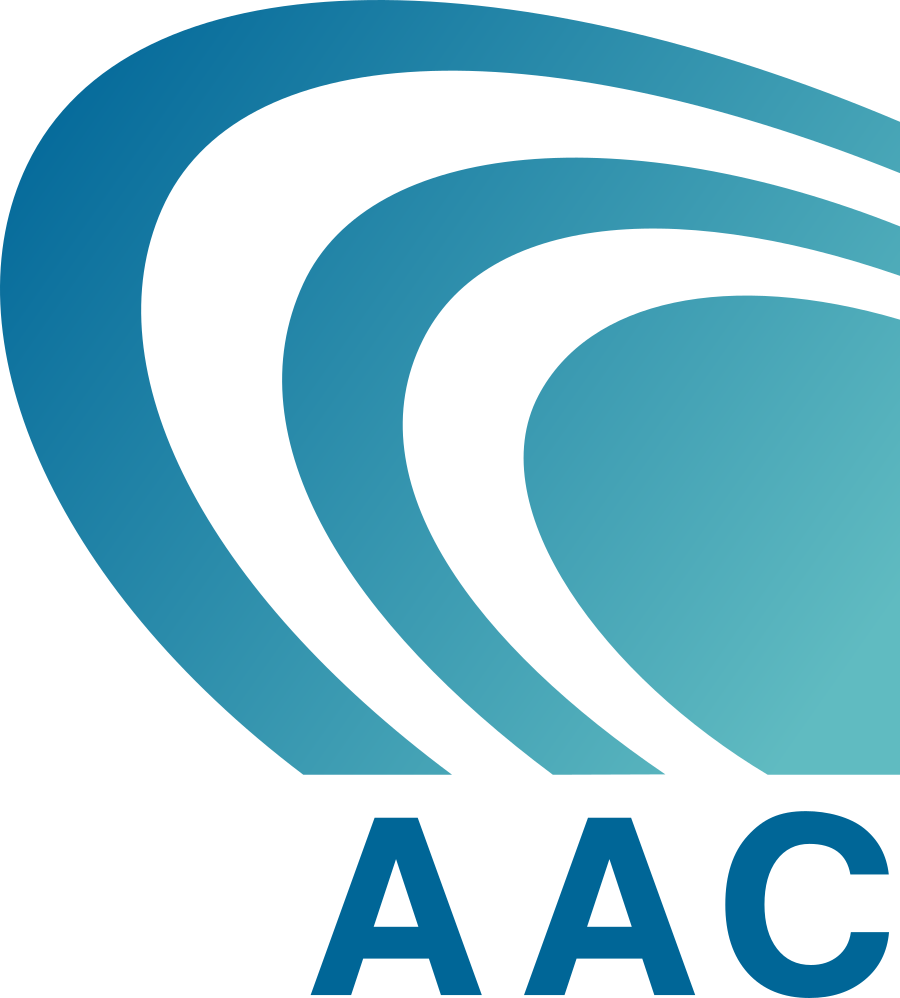
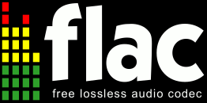

[](https://github.com/Borewit/music-metadata/actions/workflows/ci.yml)
[](https://npmjs.org/package/music-metadata)
[](https://npmcharts.com/compare/music-metadata?start=600&interval=7)
[](https://codecov.io/gh/Borewit/music-metadata)
[](https://github.com/Borewit/music-metadata/actions/workflows/codeql-analysis.yml)
[](https://socket.dev/npm/package/music-metadata)

# music-metadata

**Read and write audio metadata in Node.js and browsers.**


`music-metadata` extracts tags, cover art and audio properties from files, streams,
buffers and Blobs in Node.js and browsers. Read common fields or native tags, and
edit tags and cover art in supported formats without re-encoding audio.

[Features](#features) · [Compatibility](#compatibility) · [Sponsoring](#sponsoring) · [Installation](#installation) · [Reading API](#reading-metadata) · [Parsing options](#ioptions-interface) · [Writing API](#writing-metadata) · [FAQ](#frequently-asked-questions)

## Features

The API is promise-based and includes TypeScript types. Audio properties include
duration, codec, [bitrate](https://wikipedia.org/wiki/Bit_rate), sample rate,
[bit depth](https://wikipedia.org/wiki/Audio_bit_depth), track information and
encoding profile (e.g. [CBR](https://en.wikipedia.org/wiki/Constant_bitrate), V0, V2).
See [audio properties](#metadataformat) for details. Custom tokenizers are also
supported.

Native tags map to common fields in `metadata.common`: APEv2 `Title`, Vorbis
`TITLE` and ID3v2 `TIT2` all become `title`. Writers map common fields back to the
file's conventional tag format. Legacy tags remain readable; new tags use current
formats. Update files in Node.js or return new buffers in Node.js and browsers;
see [Writing metadata](#writing-metadata) for supported formats.


### Support for audio file types

Supported **read** formats are listed below. See [Writing metadata](#writing-metadata)
for write support and examples.

| Audio format                                                              | Description                                               | Logo                                                                                             |
|---------------------------------------------------------------------------|-----------------------------------------------------------|--------------------------------------------------------------------------------------------------|
| [AIFF / AIFF-C](https://wikipedia.org/wiki/Audio_Interchange_File_Format) | Audio Interchange File Format                             |      |
| [AAC](https://en.wikipedia.org/wiki/Advanced_Audio_Coding)                | ADTS / Advanced Audio Coding                              |                               |
| [APE](https://wikipedia.org/wiki/Monkey's_Audio)                          | Monkey's Audio                                            |                          |
| [ASF](https://wikipedia.org/wiki/Advanced_Systems_Format)                 | Advanced Systems Format                                   |                                                                                                  |
| [BWF](https://en.wikipedia.org/wiki/Broadcast_Wave_Format)                | Extended WAV format for broadcast and archiving           |                                                                                                  |
| [CAF](https://en.wikipedia.org/wiki/Core_Audio_File_Format)               | Core Audio File Format                                    |      |
| [DSDIFF](https://wikipedia.org/wiki/Direct_Stream_Digital)                | Philips DSDIFF                                            |                                        |
| [DSF](https://wikipedia.org/wiki/Direct_Stream_Digital)                   | Sony's DSD Stream File                                    |                                        |
| [FLAC](https://wikipedia.org/wiki/FLAC)                                   | Free Lossless Audio Codec                                 |                                      |
| [MP2](https://wikipedia.org/wiki/MPEG-1_Audio_Layer_II)                   | MPEG-1 Audio Layer II (predecessor to MP3)                |                                                                                                  |
| [Matroska](https://wikipedia.org/wiki/Matroska)                           | Matroska (EBML), mka, mkv                                 |                         |
| [MP3](https://wikipedia.org/wiki/MP3)                                     | MPEG-1 / MPEG-2 Audio Layer III                           |                                      |
| [MPC](https://wikipedia.org/wiki/Musepack)                                | Musepack SV7                                              |                              |
| [MPEG 4](https://wikipedia.org/wiki/MPEG-4)                               | mp4, m4a, m4v                                             |                            |
| [Ogg](https://en.wikipedia.org/wiki/Ogg)                                  | Open container format                                     |                                        |
| [Opus](https://wikipedia.org/wiki/Opus_(audio_format))                    | Low-latency, high-quality codec for speech and music      |                                      |
| [Speex](https://wikipedia.org/wiki/Speex)                                 | Open-source speech codec optimized for VoIP               |                               |
| [Theora](https://en.wikipedia.org/wiki/Theora)                            | Open video compression format (typically paired with Ogg) |                             |
| [Vorbis](https://wikipedia.org/wiki/Ogg_Vorbis)                           | Vorbis audio compression                                  |                  |
| [WAV](https://wikipedia.org/wiki/WAV)                                     | Uncompressed PCM audio in RIFF container                  |                                                                                                  |
| [WebM](https://wikipedia.org/wiki/WebM)                                   | WebM                                                      |                                  |
| [WV](https://wikipedia.org/wiki/WavPack)                                  | WavPack                                                   |                                |
| [WMA](https://wikipedia.org/wiki/Windows_Media_Audio)                     | Windows Media Audio                                       |  |

### Supported tag headers

Supported tag formats:
- [APE](https://wikipedia.org/wiki/APE_tag)
- [ASF](https://wikipedia.org/wiki/Advanced_Systems_Format)
- EXIF 2.3
- [ID3](https://wikipedia.org/wiki/ID3): ID3v1, ID3v1.1, ID3v2.2, [ID3v2.3](http://id3.org/id3v2.3.0), [ID3v2.4](http://id3.org/id3v2.4.0-frames) and [ID3v2 Chapters 1.0](https://mutagen-specs.readthedocs.io/en/latest/id3/id3v2-chapters-1.0.html)
- [iTunes](https://github.com/sergiomb2/libmp4v2/wiki/iTunesMetadata)
- [RIFF](https://wikipedia.org/wiki/Resource_Interchange_File_Format)/INFO
- [Vorbis comment](https://wikipedia.org/wiki/Vorbis_comment)
- [AIFF](https://wikipedia.org/wiki/Audio_Interchange_File_Format)
- [CAF](https://developer.apple.com/library/archive/documentation/MusicAudio/Reference/CAFSpec/CAF_spec/CAF_spec.html)

Supported lyric formats:
- [LRC](https://en.wikipedia.org/wiki/LRC_(file_format))
- Synchronized lyrics (SYLT)
- Unsynchronized lyrics (USLT)

Also reads [MusicBrainz](https://musicbrainz.org/) tags written by
[Picard](https://picard.musicbrainz.org/) and
[ReplayGain](https://wiki.hydrogenaud.io/index.php?title=ReplayGain) tags.

## Compatibility

- **Node.js:** Requires [Node.js ≥ 22](https://nodejs.org/en/about/previous-releases).
- **Browsers:** Use a module bundler.
  [File-system functions](#nodejs-specific-functions) are Node.js-only; buffer, Blob and web-stream [reading functions](#cross-platform-functions) are cross-platform.
- **Modules:** [ESM](https://gist.github.com/sindresorhus/a39789f98801d908bbc7ff3ecc99d99c) since version 8.
  See [CommonJS backward compatibility](#commonjs-backward-compatibility) in the FAQ.
- **JavaScript target:** [ECMAScript 2023 (14th Edition)](https://262.ecma-international.org/14.0/).

## Online demos
- [ Audio Tag Analyzer](https://audio-tag-analyzer.netlify.app/) ([source code](https://github.com/Borewit/audio-tag-analyzer-vite))
- [ICY Radio Stream Player](https://icy-radio-stream-player.netlify.app/)
- [Overtone](https://overtone.pro/) by [Johannes Schickling](https://github.com/schickling)

See [projects using music-metadata](https://github.com/Borewit/music-metadata/network/dependents).

## Sponsoring

Support maintenance and development by
[sponsoring Borewit on GitHub](https://github.com/sponsors/Borewit) or buying me a coffee:

<a href="https://www.buymeacoffee.com/borewit" target="_blank"></a>

<div align="center">
  <h2>Sponsors</h2>
  <br />
  <a href="https://coderabbit.link/borewit">
    <picture>
      <source media="(prefers-color-scheme: dark)" srcset="image/coderabbit-dark.svg" />
      <source media="(prefers-color-scheme: light)" srcset="image/coderabbit-light.svg" />
      
    </picture>
  </a>
  <br />
  <p>Code reviews powered by CodeRabbit</p>
</div>

## Installation

```bash
npm install music-metadata
```

Or with Yarn:

```bash
yarn add music-metadata
```

## API Documentation

### Reading metadata

Choose a function based on your input:

| Input | Function | Environment |
| --- | --- | --- |
| File path | [`parseFile`](#parsefile-function) | Node.js |
| Node.js `Readable` stream | [`parseStream`](#parsestream-function) | Node.js |
| Web `ReadableStream` | [`parseWebStream`](#parsewebstream-function) | Node.js and browsers |
| `Blob` or `File` | [`parseBlob`](#parseblob-function) | Node.js and browsers |
| `Uint8Array` or Node.js `Buffer` | [`parseBuffer`](#parsebuffer-function) | Node.js and browsers |
| Custom `ITokenizer` | [`parseFromTokenizer`](#parsefromtokenizer-function) | Depends on the tokenizer |

All parsing functions return a [`Promise<IAudioMetadata>`](#iaudiometadata-interface)
with [common tags](#metadatacommon), [native tags](#metadatanativetyped),
[audio properties](#metadataformat) and parsing warnings.
See [`IOptions`](#ioptions-interface) for parsing options and
[Handling Parse Errors](#handling-parse-errors) for error handling.

The optional `fileInfo` argument accepts a [MIME type](https://developer.mozilla.org/en-US/docs/Web/HTTP/Basics_of_HTTP/MIME_types)
string or an `IFileInfo` object with optional `mimeType`, `size` (bytes) and `path` (filename).
The parser detects the format from the content, falling back to the MIME type and
then the filename extension when needed. Pass the size when known; some streamed
formats need it to calculate duration.

> [!NOTE]
> File access in Node.js is generally faster than streaming because the parser can seek without reading intermediate data.

#### Node.js specific functions
These functions are available only in Node.js.

##### `parseFile` function

Reads metadata from a local audio file.

```ts
parseFile(filePath: string, options?: IOptions): Promise<IAudioMetadata>
```

`filePath` must resolve to a regular file; symlinks are supported. Directories,
FIFOs (named pipes) and other non-regular objects reject with `NotRegularFileError`
from `strtok3`.
FIFOs are rejected without waiting for a writer. Use [`parseStream()`](#parsestream-function)
for streamed audio or [parseBlob](#parseblob-function) for browser
[File](https://developer.mozilla.org/en-US/docs/Web/API/File) objects.

```js
import { parseFile } from 'music-metadata';
import { inspect } from 'node:util';

(async () => {
  try {
    const filePath = 'test/samples/mp3/MusicBrainz - Beth Hart - Sinner\'s Prayer [id3v2.3].V2.mp3';
    const metadata = await parseFile(filePath);

    console.log(inspect(metadata, { showHidden: false, depth: null }));
  } catch (error) {
    console.error('Error parsing metadata:', error.message);
  }
})();
```

##### `parseStream` function

Reads metadata from a Node.js [`Readable`](https://nodejs.org/api/stream.html#class-streamreadable) stream.

```ts
parseStream(stream: Readable, fileInfo?: IFileInfo | string, options?: IOptions): Promise<IAudioMetadata>
```

```js
import { parseStream } from 'music-metadata';
import { createReadStream } from 'fs';

(async () => {
  try {
    const audioStream = createReadStream('path/to/audio/file.mp3');

    const metadata = await parseStream(audioStream, { mimeType: 'audio/mpeg' });

    console.log(metadata);
  } catch (error) {
    console.error('Error parsing metadata:', error.message);
  }
})();
```

#### Cross-platform functions
These functions work in Node.js and browsers.
Custom tokenizers may have their own platform requirements.

##### `parseWebStream` function

Reads metadata from a web [ReadableStream](https://developer.mozilla.org/en-US/docs/Web/API/ReadableStream/ReadableStream)
of `Uint8Array` chunks, such as a `fetch` response body.

```ts
parseWebStream(webStream: ReadableStream<Uint8Array>, fileInfo?: IFileInfo | string, options?: IOptions): Promise<IAudioMetadata>
```

```js
import { parseWebStream } from 'music-metadata';

(async () => {
  try {
    const response = await fetch('https://github.com/Borewit/test-audio/raw/refs/heads/master/Various%20Artists%20-%202008%20-%20netBloc%20Vol%2013%20-%20Color%20in%20a%20World%20of%20Monochrome%20%5BAAC-40%5D/1.02.%20Solid%20Ground.m4a');

    const contentLength = response.headers.get('Content-Length');
    const size = contentLength ? parseInt(contentLength, 10) : undefined;

    const metadata = await parseWebStream(response.body, {
      mimeType: response.headers.get('Content-Type'),
      size // Pass the content length when available
    });

    console.log(metadata);
  } catch (error) {
    console.error('Error parsing metadata:', error.message);
  }
})();
```

Pass the [`fetch`](https://developer.mozilla.org/en-US/docs/Web/API/Fetch_API) response body directly to `parseWebStream`.

##### `parseBlob` function

Reads metadata from a [Blob](https://developer.mozilla.org/en-US/docs/Web/API/Blob)
or browser `File` using Blob slices.
The Blob's size and MIME type are passed to the parser.

```ts
parseBlob(blob: Blob, options?: IOptions): Promise<IAudioMetadata>
```

```js
import { parseBlob } from 'music-metadata';

(async () => {
  const fileInput = document.querySelector('input[type="file"]');
  const file = fileInput.files[0];

  try {
    const metadata = await parseBlob(file);
    console.log(metadata);
  } catch (error) {
    console.error('Error parsing metadata:', error.message);
  }
})();
```

##### `parseBuffer` function

Reads metadata from audio bytes held in a [Uint8Array](https://developer.mozilla.org/en-US/docs/Web/JavaScript/Reference/Global_Objects/Uint8Array) or Node.js [Buffer](https://nodejs.org/api/buffer.html).

```ts
parseBuffer(uint8Array: Uint8Array, fileInfo?: IFileInfo | string, options?: IOptions): Promise<IAudioMetadata>
```

```js
import { parseBuffer } from 'music-metadata';
import fs from 'fs';

(async () => {
  const buffer = fs.readFileSync('path/to/audio/file.mp3');

  try {
    const metadata = await parseBuffer(buffer, { mimeType: 'audio/mpeg' });
    console.log(metadata);
  } catch (error) {
    console.error('Error parsing metadata:', error.message);
  }
})();
```

##### `parseFromTokenizer` function
Reads metadata through a [strtok3](https://github.com/Borewit/strtok3) `ITokenizer` for custom data sources, including S3 objects and HTTP range requests.

Use [streaming-http-token-reader](https://github.com/Borewit/streaming-http-token-reader)
for chunked HTTP(S) reads with [HTTP range requests](https://developer.mozilla.org/en-US/docs/Web/HTTP/Range_requests).

```ts
parseFromTokenizer(tokenizer: ITokenizer, options?: IOptions): Promise<IAudioMetadata>
```

````js
import { fromNodeProviderChain } from '@aws-sdk/credential-providers';
import { S3Client } from '@aws-sdk/client-s3';
import { makeTokenizer } from '@tokenizer/s3';
import { parseFromTokenizer as mmParseFromTokenizer } from 'music-metadata';

const s3 = new S3Client({
  region: 'eu-west-2',
  credentials: fromNodeProviderChain(),
});

async function makeS3TestDataTokenizer(key, options) {
  return await makeTokenizer(s3, {
    Bucket: 'music-metadata',
    Key: key,
  }, options);
}

async function readMetadata() {
  try {
    const tokenizer = await makeS3TestDataTokenizer('path/to/audio/file.mp3', { disableChunked: false });

    const metadata = await mmParseFromTokenizer(tokenizer);

    console.log(metadata);
  } catch (error) {
    console.error('Error parsing metadata:', error.message);
  }
}

readMetadata();
````

See [strtok3](https://github.com/Borewit/strtok3) for the `ITokenizer` interface,
and [@tokenizer/s3](https://github.com/Borewit/tokenizer-s3) and the
[AWS SDK for JavaScript](https://aws.amazon.com/sdk-for-javascript/) for S3 access.

#### Handling Parse Errors

Parsing can reject with the library's exported `Error` subclasses or filesystem,
stream and tokenizer errors. In TypeScript, treat caught values as `unknown` and
narrow them before accessing properties. `UnionOfParseErrors` covers only the
library errors, not every possible rejection:
```ts
export type UnionOfParseErrors =
  | CouldNotDetermineFileTypeError
  | UnsupportedFileTypeError
  | UnexpectedFileContentError
  | FieldDecodingError
  | InternalParserError;
```

- `CouldNotDetermineFileTypeError`: The file type could not be detected.
- `UnsupportedFileTypeError`: The detected file type is unsupported.
- `UnexpectedFileContentError`: The content does not match the expected format.
- `FieldDecodingError`: A metadata field could not be decoded.
- `InternalParserError`: An internal parser error occurred.

#### Other functions

##### `orderTags` function

Converts an array of native tags to a dictionary keyed by tag identifier.
Each value is an array of tag values.

```ts
orderTags(nativeTags: ITag[]): INativeTagDict
```

Typed lists retain their value types: ID3 `TIT2` and Vorbis `TITLE` are strings,
`APIC` values are pictures and `MCDI` values are `Uint8Array`s. Known identifiers
are typed for ID3v1, ID3v2.2/2.3/2.4, Vorbis (FLAC/Opus/Speex), APEv2, ASF,
MP4/iTunes, RIFF INFO/BWF (`exif`), Matroska, AIFF and CAF. ASF, APEv2, MP4 and
Matroska allow multiple value types per identifier, which may need narrowing.

Raw `metadata.native` lists retain `unknown` values for backward compatibility;
`orderTags` groups them without inferring types. For typed parsed tags, use
[`metadata.nativeTyped`](#metadatanativetyped). Custom type maps are supported
through the `INativeTag` and `INativeTagDict` generics.

```js
import { parseFile, orderTags } from 'music-metadata';
import { inspect } from 'util';

(async () => {
  try {
    const metadata = await parseFile('../test/samples/mp3/MusicBrainz - Beth Hart - Sinner\'s Prayer [id3v2.3].V2.mp3');
    const orderedTags = orderTags(metadata.native['ID3v2.3'] ?? []);
    console.log(inspect(orderedTags, { showHidden: false, depth: null }));
  } catch (error) {
    console.error(error.message);
  }
})();
```

##### `ratingToStars` function

Converts a normalized rating to 0–5 stars: 0 means unrated, 1 is the lowest rating
and 5 is the highest.

```ts
ratingToStars(rating: number | undefined): number
```

##### `selectCover` function

Selects a [cover image](#access-cover-art) by picture type, falling back to the
first picture.

```ts
export function selectCover(pictures?: IPicture[]): IPicture | null
```

```js
import { parseFile, selectCover } from 'music-metadata';

(async () => {
  const { common } = await parseFile(filePath);
  const cover = selectCover(common.picture);
})();
```

##### `getSupportedMimeTypes` function

Returns supported MIME types, including some unofficial types.
See [Support for audio file types](#support-for-audio-file-types) for the supported formats.

#### `IOptions` Interface
- `duration`: `boolean` (default: `false`)

  Allows extra scanning, up to the entire file, to calculate duration when needed.
  [`format.duration`](#metadataformat) may already be available without this option;
  enabling it does not guarantee a result.

  For Matroska/WebM, including `MediaRecorder` recordings, missing duration is
  estimated from block timestamps without reading encoded frames. Existing
  duration is preserved; recovered track durations appear in
  [`format.trackInfo`](#metadataformattrackinfo). Estimates may be approximate;
  a single block without duration information remains unknown.

- `includeChapters`: `boolean` (default: `false`)
  Reads MP4 [QuickTime chapter tracks and Nero `chpl` lists](#metadataformatchapters),
  preferring a usable QuickTime track. Files, buffers and Blobs support either
  `moov`/`mdat` order; forward-only streams require `moov` before the chapter data.

- `maxChapterCount`: `number` (default: `1000`)

  Maximum chapters returned from QuickTime/Nero MP4 and ID3v2 lists. Must be a
  positive safe integer; excess chapters are omitted with a warning. MP4 chapters
  also require `includeChapters: true`.

- `maxMemoryAllocation`: `number` (default: `67108864`, 64 MiB)

  Maximum bytes buffered for one metadata payload, accumulated Ogg packet or
  tokenizer stream lookahead. Must be a positive safe integer. Oversized payloads
  are rejected before allocation; tokenizer allocations and lookahead reject with
  `strtok3.BufferSizeError`.

  The limit applies to the parser's `strtok3` tokenizers, including embedded tags.
  With [`parseFromTokenizer()`](#parsefromtokenizer-function), also set
  `maxBufferSize` when creating the supplied tokenizer. Increase the limit for
  large metadata or cover art, or lower it in memory-constrained environments.
  Skipped audio/video data does not count. This is not a total memory cap:
  decoded metadata, retained tags and temporary copies need additional memory.

- `maxMetadataEntries`: `number` (default: `100000`)

  Maximum entries per decoded user metadata list or table. Must be a positive
  safe integer. Independent of `maxMemoryAllocation`; it does not cap total
  collected metadata or process memory.

- `mkvUseIndex`: `boolean` (default: `false`)

  Uses Matroska's SeekHead index to skip segment and cluster elements. Experimental:
  metadata absent from the index may be missed; without a SeekHead, it has no effect.

  Useful for large MKV files on network shares with a reliable index. Default
  traversal reads every cluster header, so network latency can dominate even
  though audio/video payloads are skipped.

- `observer`: `(update: IMetadataEvent) => void`:

  Called synchronously after common tags or format properties change. Returned
  promises are not awaited; unchanged primitive format values do not trigger
  callbacks. Keep it lightweight or batch expensive work in your application.

- `skipCovers`: `boolean` (default: `false`)

  Skips embedded cover art to reduce memory use and processing. MP4 JPEG/PNG data
  is skipped before buffering and may exceed `maxMemoryAllocation`; buffered
  metadata remains subject to the limit.

- `skipPostHeaders`: `boolean` (default: `false`)
  Skips tags at the end of the file, avoiding a full-stream read when those tags
  are not needed.

#### `IAudioMetadata` interface

The returned `IAudioMetadata` object contains:
- [`metadata.format`](#metadataformat): Audio properties.
- [`metadata.common`](#metadatacommon): Normalized tags shared across formats.
- [`metadata.format.trackInfo`](#metadataformattrackinfo): Individual audio and video tracks, when available.
- `metadata.native`: Original tag arrays, grouped by format.
- [`metadata.nativeTyped`](#metadatanativetyped): Typed dictionaries of the same values, grouped by format and identifier.
- `metadata.quality.warnings`: Non-fatal parsing warnings with a `message` string.

##### `metadata.nativeTyped`

Always present, even when no native tags were found. Known identifiers have
format-specific types; custom identifiers and formats have `unknown` values.
Each entry is an array that preserves duplicates and their order. Missing formats
and identifiers are `undefined`.

```ts
const metadata = await parseFile(filePath);
const titles = metadata.nativeTyped.vorbis?.TITLE; // string[] | undefined
const pictures = metadata.nativeTyped['ID3v2.4']?.APIC; // IPicture[] | undefined
const custom = metadata.nativeTyped.vorbis?.MY_CUSTOM_TAG; // unknown[] | undefined
```

Each access builds a fresh snapshot of the current `native` lists, including in
observer callbacks. Read it once for multiple lookups. Grouping dictionaries and
arrays are new, but pictures, binary data and other objects are shared with
`native`. Changing grouping arrays does not change the raw lists.

`ITypedNativeTags`, `ITypedNativeTagDict`, `INativeAudioMetadata` and
[`IAudioMetadata`](#iaudiometadata-interface) accept custom type maps.
The view does not convert or validate values. Manually constructed metadata and
mocks must also provide the required `nativeTyped` property.

##### `metadata.format`

Audio properties from `IFormat`; `?` marks optional fields:
- `format.container?: string` Audio encoding format. e.g.: 'flac'
- `format.codec?` Codec name
- `format.codecProfile?: string` Codec profile / settings
- `format.tagTypes?: TagType[]`  List of tagging formats found in parsed audio file
- `format.duration?: number` Duration in seconds (existing audio/container summary; complete presentation duration for video-only files)
- `format.bitrate?: number` Existing audio/container summary bitrate in bits per second
- `format.containerDuration?: number` Complete media presentation duration in seconds, including video
- `format.overallBitrate?: number` Average bitrate of the entire file in bits per second, including container overhead; requires a known file size and presentation duration
- `format.sampleRate?: number` Sampling rate in Samples per second (S/s)
- `format.bitsPerSample?: number` Audio bit depth
- `format.lossless?: boolean` `true` for lossless, `false` for lossy encoding
- `format.numberOfChannels?: number` Number of audio channels
- `format.creationTime?: Date` Track creation time
- `format.modificationTime?: Date` Track modification / tag update time
- `format.trackGain?: number` Track gain in dB
- `format.albumGain?: number` Album gain in dB
- [`format.chapters?: IChapter[]`](#metadataformatchapters) Chapter titles and timestamps, when available

##### `metadata.format.chapters`

Each `IChapter` has a `title` (possibly empty), `start` and optional `end`.
For MP4 QuickTime and Nero lists, set [`includeChapters: true`](#ioptions-interface).

Divide timestamps by the chapter's `timeScale` to get seconds; omitted `timeScale`
means **1** (seconds), not milliseconds or the audio sample rate. QuickTime tracks
with a missing or zero timescale are rejected, falling back to Nero if available.

| Chapter source | Timestamp units | `timeScale` |
| --- | --- | --- |
| ID3v2 CHAP | Seconds | Omitted (equivalent to `1`) |
| MP4 QuickTime chapter track | Chapter track time units | Chapter track's timescale |
| MP4 Nero `chpl` | 100-nanosecond units | `10000000` |

```js
import { parseFile } from 'music-metadata';

const { format } = await parseFile('audiobook.m4b', { includeChapters: true });
const chapters = (format.chapters ?? []).map(chapter => {
  const timeScale = chapter.timeScale ?? 1;
  return {
    title: chapter.title,
    startSeconds: chapter.start / timeScale,
    endSeconds: chapter.end === undefined ? undefined : chapter.end / timeScale
  };
});
```

If `end` is omitted, derive it in your application if needed.
`sampleOffset`, when present, is an audio sample position, not a timestamp scale.
For editing chapters, see [MP4 chapters](#mp4-chapters).

##### `metadata.format.trackInfo`

An array of [trackInfo](#trackinfo) objects for single-stream files and multi-track
containers (MPEG-4, Matroska, ASF and Ogg), empty when no track information is
available. Use `TrackType` to select audio, video, subtitle or metadata tracks:

```js
import { parseFile, TrackType } from 'music-metadata';

const { format } = await parseFile('movie.mp4', { duration: true });
const audioTracks = format.trackInfo.filter(track => track.type === TrackType.audio);
const videoTracks = format.trackInfo.filter(track => track.type === TrackType.video);
for (const track of videoTracks) {
  console.log(track.duration, track.bitrate, track.video?.pixelWidth, track.video?.pixelHeight);
  console.log(track.video?.frameRate);
}
console.log(format.containerDuration, format.overallBitrate);
```

Track fields may be absent. Select by type, language and flags, not array order.
Set [`duration: true`](#ioptions-interface) to allow extra scanning for timing
information. For whole-file duration and average bitrate, use
`format.containerDuration` and `format.overallBitrate`.

###### trackInfo

Per-track properties from `ITrackInfo`:
- `trackInfo.id?: number` Container track ID/number, or Ogg stream serial number; only meaningful within the file
- `trackInfo.type?: TrackType` Track type (`audio`, `video`, `subtitle`, `metadata`, or other known types)
- `trackInfo.codecId?: string` Container-specific codec identifier, such as `mp4a`, `A_AAC`, or ASF audio format tag `0x0161`
- `trackInfo.codecName?: string` Codec name
- `trackInfo.codecProfile?: string` Codec profile
- `trackInfo.duration?: number` Track duration in seconds
- `trackInfo.bitrate?: number` Encoded track bitrate in bits per second
- `trackInfo.lossless?: boolean` Whether the track uses lossless compression
- `trackInfo.codecSettings?: string` Codec settings
- `trackInfo.flagEnabled?: boolean` Whether the track is enabled; Matroska defaults to `true`, MPEG-4 uses the track header flag
- `trackInfo.flagDefault?: boolean` Whether the container marks the track as a default selection; Matroska defaults to `true`
- `trackInfo.flagForced?: boolean` Whether a subtitle track should be displayed without explicit selection
- `trackInfo.flagLacing?: boolean` Whether a Matroska track may contain blocks using lacing; defaults to `true`
- `trackInfo.name?: string` A human-readable track name.
- `trackInfo.language?: string` Specifies the language of the track
- `trackInfo.audio?: IAudioTrack`, see [`trackInfo.audio`](#trackinfoaudio)
- `trackInfo.video?: IVideoTrack`, see [`trackInfo.video`](#trackinfovideo)

###### `trackInfo.audio`

- `trackInfo.audio.numberOfSamples?: number` Number of decoded sample frames (one sample per channel), when known
- `trackInfo.audio.samplingFrequency?: number` Sample rate in hertz; for Opus, the informational original input rate
- `trackInfo.audio.outputSamplingFrequency?: number` Output sample rate in hertz; Opus granules and sample counts use 48000 Hz
- `trackInfo.audio.channels?: number`
- `trackInfo.audio.channelPositions?: Uint8Array`
- `trackInfo.audio.bitDepth?: number`

###### `trackInfo.video`

- `trackInfo.video.frameRate?: number` Frames per second, when known
- `trackInfo.video.flagInterlaced?: boolean`
- `trackInfo.video.stereoMode?: number`
- `trackInfo.video.pixelWidth?: number`
- `trackInfo.video.pixelHeight?: number`
- `trackInfo.video.displayWidth?: number`
- `trackInfo.video.displayHeight?: number`
- `trackInfo.video.displayUnit?: number`
- `trackInfo.video.aspectRatioType?: number`
- `trackInfo.video.colourSpace?: Uint8Array`
- `trackInfo.video.gammaValue?: number`

##### `metadata.common`

See the generated [common tag reference](doc/common_metadata.md).

Artist credits (`artist`, `albumArtist`) and name lists (`artists`, `albumArtists`)
are independent when writing: editing one does not change the other. Writers use
Picard-compatible `ARTISTS` and `ALBUMARTISTS` fields in ID3 TXXX frames, MP4 iTunes
freeform atoms, Vorbis/APEv2 tags and ASF `WM/` attributes. Legacy list aliases are
readable and replaced when the list is edited.

If only a list is stored, the reader derives a display credit from it. Clearing a
list removes its fields and aliases, but repeated legacy display values can still
produce a list on read. To prevent that fallback while keeping the credit, write
a single display credit in the same patch.

Artist accessors provide fallbacks without changing the fields:

- `common.getArtist(): string | undefined` returns `common.artist` when present,
  otherwise joins `common.artists` as `"A & B"` or `"A, B & C"`.
- `common.getArtists(): string[] | undefined` returns `common.artists` when present,
  otherwise returns `[common.artist]`.
  A credit such as `"A feat. B"` is not split.

Both return `undefined` when no value or fallback exists; an empty list produces
no display credit. A single credit leaves `common.artists` undefined. The methods
are non-enumerable, so spreading or JSON-serializing `common` includes only tag fields.

```ts
const metadata = await parseFile('audio.mp3');
const credit = metadata.common.getArtist();
const artists = metadata.common.getArtists();
```


#### Examples

For streamed formats that need file size to calculate duration, pass the size in
bytes to [`parseStream`](#parsestream-function) with [`duration: true`](#ioptions-interface):
```js
import { parseStream } from 'music-metadata';
import { inspect } from 'util';

(async () => {
    const metadata = await parseStream(someReadStream, {mimeType: 'audio/mpeg', size: 26838}, {duration: true});
    console.log(inspect(metadata, {showHidden: false, depth: null}));
    someReadStream.close();
  }
)();
```

##### Access cover art

`metadata.common.picture` contains embedded pictures, when present:

```ts
export interface IPicture {
  format: string; // Image MIME type
  data: Uint8Array; // Image bytes
  description?: string;
  type?: string; // Picture type, e.g. front cover
}
```

Use [`selectCover`](#selectcover-function) to choose a cover from multiple pictures.

To display a picture in an HTML `img` element:
```js
const coverUrl = URL.createObjectURL(new Blob([picture.data], {type: picture.format}));
img.src = coverUrl;
```

Call `URL.revokeObjectURL(coverUrl)` when the picture is no longer needed.

For the internal design and dependencies, see the [architecture guide](doc/architecture.md).

### Writing metadata

Write tags without re-encoding audio in FLAC, Ogg Vorbis/Opus, MP3, ADTS AAC,
WAV, WMA/ASF, MP4/M4A/M4B, Monkey’s Audio, WavPack and Musepack files.

#### Update existing metadata

Read the existing tags with [`parseFile`](#parsefile-function), then pass the
fields you want to change to `updateFile`:

```js
import { parseFile, updateFile } from 'music-metadata';

const metadata = await parseFile('track.flac');
console.log(metadata.common);

await updateFile('track.flac', {
  title: 'New title',
  artists: ['Artist A'],
  genres: null // Remove the genres
}, { backup: true });
```

Use [common field names](doc/common_metadata.md) such as `title`, `artists` and
`album`. Supplied fields are added or updated, omitted fields are preserved, and
`null` removes a field. You can skip reading if you already know the changes.

#### Native fields

For format-specific fields, inspect `metadata.native` and use the tag's native
name. For example, update a FLAC Vorbis comment:

```js
console.log(metadata.native.vorbis);

await updateFile('track.flac', {
  native: { MY_FIELD: 'New value' }
});
```

The `native` patch is a dictionary of tag names and values, not the reader's
format-grouped `metadata.native` object. Native fields are applied after common
fields; `null` removes a named field.

For FLAC, use Vorbis comment keys such as `MY_FIELD`. For MP3, ADTS AAC and WAV,
use ID3 frame IDs, or `TXXX:description` for user text. MP4 uses four-character
item names or `----:mean:name` for freeform fields. Monkey’s Audio, WavPack and
Musepack use APEv2 item names.

WMA/ASF uses attribute names. Values can be strings, binary `Uint8Array`s or
typed objects:

```js
import { updateFile } from 'music-metadata';

await updateFile('track.wma', {
  title: '作品 🎵',
  native: {
    'Custom/Text': 'Unicode text',
    'Custom/Flag': { type: 'bool', value: true },
    'Custom/Counter': { type: 'qword', value: 123n }
  }
});
```

Typed objects accept `unicode`, `binary`, `bool`, `word`, `dword`, `qword` or
`guid`. Optional `language` and `stream` select the ASF language index and audio
stream.

#### Add metadata

To add new metadata to an existing, untagged audio file, use the same API:

```js
await updateFile('untagged.flac', {
  title: 'First track',
  artists: ['Artist A'],
  album: 'New album',
  trackNumber: 1,
  trackTotal: 12
});
```

#### Update a buffer

`updateFile` is Node.js-only and replaces the file atomically by default.
For bytes in Node.js or browsers, `updateBuffer` returns a new `Uint8Array`
without changing the input; it also accepts a `Blob` in browsers:

```js
import { updateBuffer } from 'music-metadata';

const updatedBytes = await updateBuffer(originalBytes, { album: 'New album' });
```

#### API and options

`updateFile(path, patch, options?)` updates a local file in Node.js and returns a
`WriteResult` with `format`, `bytesWritten`, `paddingBytes` and `atomic`.
`updateBuffer(bytes, patch, options?)` returns a new `Uint8Array`; it also accepts
a `Blob` in browsers. The input is unchanged. Root exports select the
implementation for your environment, and named imports allow tree-shaking.

Omitted or `undefined` fields are preserved; `null` removes a field. Common fields
use the [reader's field names](doc/common_metadata.md). Writable fields include
AcoustID/MusicIP identifiers and fingerprints, MusicBrainz TRM IDs, DJ mixers,
TV/podcast metadata, and ReplayGain min/max and undo values. TV season and episode
numbers must be non-negative safe integers; podcast flags must be booleans.

File writes use atomic replacement by default. Set `backup: true` to keep a
backup, `dryRun: true` to report the planned byte count without writing, or
`atomic: false` to overwrite the file in place. Byte-identical updates leave the
file and any backup untouched, returning `bytesWritten: 0` and `atomic: false`,
including for dry runs.

`padding` sets metadata padding in bytes, defaulting to 8192 where supported.
Ogg, MP4 and APEv2 writers reject this option. For ASF, it adds header padding;
an empty patch leaves the bytes unchanged unless padding is specified.

If migrating from `music-metadata-editor`, import the write functions and types
from `music-metadata` instead.

#### Read, edit and save with MediaFile

`MediaFile` is a Node.js wrapper around `parseFile` and `updateFile`.
`MediaFile.open(path, readOptions?)` reads the file; edit `file.metadata.common`
and call `file.save(writeOptions?)` to save to the same path. Saving uses
`updateFile`'s options and `WriteResult`.

To edit an ID3v2.3 MP3 and save its common tags as ID3v2.4:

```js
import { MediaFile } from 'music-metadata';

const file = await MediaFile.open('track.mp3');
file.metadata.common.title = 'New title';
await file.save({ replaceId3: true });
```

Replacement preserves audio but discards old ID3 frames without a writable
common equivalent. To copy tags from another source, assign its parsed `common`
object to `file.metadata.common` before saving. Native tags and format properties
still describe the original file; reopen it to inspect saved tags.

#### Format limits

MP3, ADTS AAC and WAV write ID3v2.4. Existing ID3v2.2/2.3 tags require
`replaceId3: true`, which discards unspecified ID3v2 fields and removes trailing
ID3v1 tags from MP3/ADTS AAC; other trailing metadata is preserved. Without this
option, `null` only removes the ID3v2 field, so a value may remain in ID3v1.

Raw `.aac` writing supports ADTS MPEG-2/MPEG-4, not ADIF or LOAS/LATM. It validates
the first ADTS header without decoding frames or checking audio CRCs. The result
has `format: 'aac'`, including for files with leading ID3 tags.

MP4 writing requires non-fragmented, self-contained files and uses iTunes
metadata.

Monkey’s Audio 3.98+ (`.ape`), WavPack (`.wv`) and Musepack SV7/SV8 (`.mpc`) write
APEv2 tail tags with common fields, native fields and front/back cover art.
Trailing ID3v1 tags are preserved. APEv1 and files with leading ID3 tags are not
supported for writing.

WMA writing supports complete, unencrypted, audio-only ASF files and returns
`format: 'asf'`. Common fields use the reader's ASF mappings; unsupported fields
are rejected.

#### MP4 chapters

Use `chapters` to replace MP4/M4A/M4B chapters with a Nero `chpl` list:

```js
import { updateFile } from 'music-metadata';

await updateFile('audiobook.m4b', {
  chapters: [
    { title: 'Opening', start: 0 },
    { title: 'Chapter 1', start: 30 }
  ]
});
```

Timestamps use each chapter's `timeScale`, defaulting to seconds. You can pass
[chapters](#metadataformatchapters) read with
[`parseFile`](#parsefile-function) and
[`includeChapters: true`](#ioptions-interface) if they meet the Nero
limits: at most 255 chapters and 255 UTF-8 bytes per title. Starts must increase
and precede the movie duration; explicit ends must match the next start or movie
duration. Chapter URLs and pictures are unsupported. Omitted `chapters` preserves
existing chapters; `null` or `[]` removes them.

Replacing or removing chapters retires dedicated QuickTime chapter tracks but
leaves their payload bytes in `mdat`. Tracks shared with other purposes are
rejected, not deleted. The writer only generates Nero lists, which may not
display in QuickTime-only players.

## Frequently Asked Questions

### CommonJS backward compatibility

In Node.js ≥ 22.12, CommonJS projects can load `music-metadata` with `require`
in the default configuration:
```js
const mm = require('music-metadata');
```

For earlier versions, use dynamic `import()`:
```js
(async () => {
  const mm = await import('music-metadata');
})();
```

For CommonJS TypeScript projects, use `node16` or `nodenext` for the compiler's
`module` option to preserve [dynamic import](https://developer.mozilla.org/docs/Web/JavaScript/Reference/Operators/import).

If you need `module: "commonjs"`, use `load-esm`:

```ts
import {loadEsm} from 'load-esm';

(async () => {
  const mm = await loadEsm<typeof import('music-metadata')>('music-metadata');
})();
```

###  How can I traverse (a long) list of files?

Await each [`parseFile`](#parsefile-function) call before starting the next file,
or limit concurrency.
Starting a parse for every file at once can exhaust memory or file handles.

Process files sequentially with [async/await](https://javascript.info/async-await):

```js
import { parseFile } from 'music-metadata';

async function parseFiles(audioFiles) {
  for (const audioFile of audioFiles) {
    const metadata = await parseFile(audioFile);
    console.log(metadata);
  }
}
```

### Using music-metadata with TypeScript and module-resolution set to bundler.

With TypeScript's [`"bundler"` module resolution](https://www.typescriptlang.org/tsconfig/#moduleResolution),
the package root resolves to the cross-platform API by default. In server-side code,
import Node.js-specific functions from `music-metadata/node`:

```ts
import { parseFile, updateFile } from 'music-metadata/node';
```

For browser code, keep importing cross-platform functions such as `parseBlob` and
`updateBuffer` from `music-metadata`.

## Licence

Licensed under the [MIT License](LICENSE.txt).
