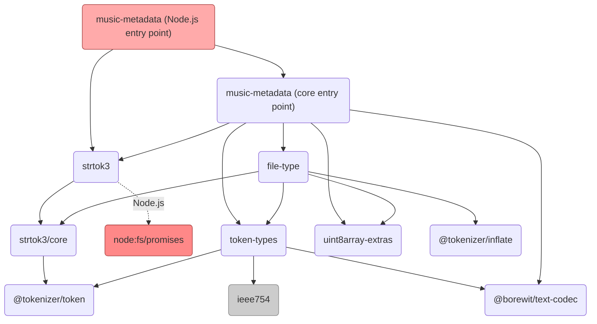

# Architecture

A contributor overview of how music-metadata reads media and maps metadata. For the public API, see the [README](../README.md).

## Entry points

| Export condition (`package.json`) | File | Functions |
|---|---|---|
| `node` | `lib/index.ts` | `parseFile`, `parseStream` (Node streams and files, via `strtok3` `fromFile`/`fromStream`). Re-exports everything from `core.ts`. |
| `default` (browsers, other runtimes) | `lib/core.ts` | `parseBuffer`, `parseBlob`, `parseWebStream`, `parseFromTokenizer`, plus helpers `orderTags`, `ratingToStars`, `selectCover`, `getSupportedMimeTypes`. Its `parseFile`/`parseStream` stubs always throw. |

The input adapters build a `strtok3` tokenizer using `getTokenizerOptions` in [Allocation.ts](../lib/common/Allocation.ts). `parseBuffer`, `parseBlob`, `parseWebStream` and `parseStream` pass it to `parseFromTokenizer`, which delegates to `ParserFactory.parse()`. `parseFile` calls the factory directly, passing a loader if its extension is recognized.

`parseFromTokenizer` accepts a caller-supplied tokenizer. The caller owns its configuration and lifecycle: `maxMemoryAllocation` still bounds parser-owned buffers, but does not set that tokenizer's `maxBufferSize`. File and stream adapters close the tokenizers they create in `finally` blocks.

## Parser selection (`lib/ParserFactory.ts`)

1. For random-access tokenizers, `scanAppendingHeaders` (in `core.ts`) looks for trailing ID3v1, Lyrics3 and APEv2 footers first.
2. `parseFile` supplies a loader when the extension is recognized. If no loader was passed in, it is chosen by MIME type (`tokenizer.fileInfo.mimeType`), then by file extension, then by sniffing the first 4,100 bytes with `file-type`. Failure raises `CouldNotDetermineFileTypeError` or `UnsupportedFileTypeError` (`lib/ParseError.ts`).
3. 14 loaders are registered: flac, mpeg, apev2, mp4, matroska, riff/wav, ogg, asf, aiff, wavpack, musepack, dsf, dsdiff and caf. Each format loader implements `IParserLoader` (`parserType`, `extensions`, `mimeTypes`, `load()`), and `load()` uses a dynamic `import()` to select the implementation. This defers loading parser implementations except for modules already imported eagerly, including `APEv2Parser` and the ID3v1 and Lyrics3 helpers used by `core.ts` for footer scanning.
4. The parser is constructed with a `MetadataCollector`, the tokenizer and the options. `parse()` runs, track info is finalized (`lib/common/TrackInfo.ts`), and `metadata.toCommonMetadata()` is returned.

## From native tags to common tags

Parsers call `MetadataCollector.addTag(tagType, id, value)` (`lib/common/MetadataCollector.ts`). The collector keeps the native tags and maps them through `CombinedTagMapper` (`lib/common/CombinedTagMapper.ts`), which has one mapper per tag format: ID3v1, ID3v2.2, ID3v2.3/ID3v2.4, MP4, Vorbis, APEv2, ASF, RIFF INFO, Matroska, AIFF and CAF. `MetadataCollector` applies tag precedence from `TagPriority` and normalizes values before returning `common`; unmapped native tags remain available in `native`. [doc-gen/gen.ts](../doc-gen/gen.ts) uses the same mappers to regenerate [common_metadata.md](common_metadata.md).

## Resource limits (`lib/common/Allocation.ts`)

| Option | Default | Scope |
|---|---|---|
| `maxMemoryAllocation` | 64 MiB | A single metadata payload, accumulated Ogg packet, tokenizer lookahead or `file-type` read buffer. |
| `maxMetadataEntries` | 100,000 | An individual decoded metadata list, table or buffered container structure. |
| `maxChapterCount` | 1,000 | Returned MP4 and ID3v2 chapters; excess chapters are omitted with a warning. MP4 chapters still require `includeChapters`. |

`ParserFactory.parse()` validates all three options as positive safe integers before scanning or parsing. Parsers use `validateAllocation`/`readBuffer`/`readToken` before allocating buffers from untrusted lengths, and the entry/chapter helpers where those limits apply. These are per-buffer or per-structure limits, not a cap on total process memory or total collected metadata. See [test-allocation-limits.ts](../test/test-allocation-limits.ts).

## Known import cycles

- `lib/core.ts` ↔ `lib/ParserFactory.ts` (`ParserFactory` imports `scanAppendingHeaders`).
- `lib/id3v2/FrameParser.ts` ↔ `lib/id3v2/FrameHeader.ts` (`FrameHeader` imports `Id3v2ContentError`).

Both work under ESM because the imported values are only used at call time.

## Adding a format

1. Add `lib/<format>/` with a loader and parser implementing the interfaces in [ParserFactory.ts](../lib/ParserFactory.ts). Reuse shared tag readers when the format embeds ID3v2, APEv2 or Vorbis comments.
2. Register the loader in the `ParserFactory` constructor, declare its extensions and MIME types, and add its identifier to `ParserType` in [lib/type.ts](../lib/type.ts).
3. For a new native tag format, register a mapper in [CombinedTagMapper.ts](../lib/common/CombinedTagMapper.ts). Add the tag identifier to `TagType` in [GenericTagTypes.ts](../lib/common/GenericTagTypes.ts) and to `TagPriority` in [MetadataCollector.ts](../lib/common/MetadataCollector.ts); without a priority entry, mapped tags are silently dropped.
4. Apply the allocation, entry and chapter limits when reading untrusted lengths or counts.
5. Add a `test/test-file-<format>.ts` suite for a new format. Extend the matching suite for an existing format; DSDIFF uses `test/test-dsdiff.ts`. Use small local fixtures in `test/samples` and follow [CONTRIBUTING.md](../CONTRIBUTING.md#unit-tests-and-fixtures).

## Dependencies

The main binary-reading dependencies are shown below. `strtok3` selects its Node.js or runtime-neutral entry point through export conditions; its file-system support is only loaded in Node.js. `file-type` uses `strtok3/core` directly.

Direct dependencies and their roles (see [package.json](../package.json) for versions):

| Dependency | Role |
|---|---|
| [strtok3](https://github.com/Borewit/strtok3) | Tokenizers for files, buffers, blobs and streams. |
| [@tokenizer/token](https://github.com/Borewit/tokenizer-token) | Token interfaces shared by tokenizers and binary decoders. |
| [token-types](https://github.com/Borewit/token-types) | Binary numeric and string tokens. |
| [file-type](https://github.com/sindresorhus/file-type) | Media format sniffing and cover-art MIME detection. |
| [@borewit/text-codec](https://github.com/Borewit/text-codec) | Metadata text encoding and decoding. |
| [uint8array-extras](https://github.com/sindresorhus/uint8array-extras) | Byte-array utilities. |
| [content-type](https://github.com/jshttp/content-type), [media-typer](https://github.com/jshttp/media-typer) | Content-Type and MIME parsing for loader selection. |
| [debug](https://github.com/debug-js/debug) | Namespaced diagnostic logging. |
| [win-guid](https://github.com/Borewit/win-guid) | Windows GUID decoding for ASF. |
